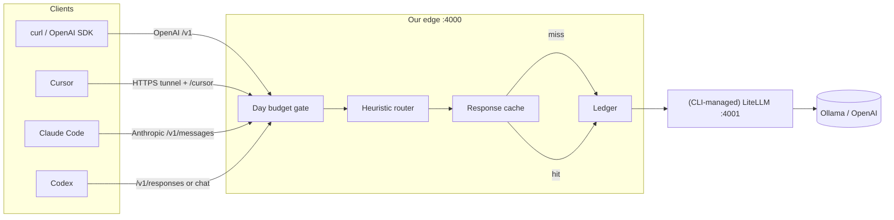

# Harbor AI Gateway

**Harbor** (short for **Harbor AI Gateway**) is a personal local AI gateway that wraps [LiteLLM](https://docs.litellm.ai/) with a thin edge you own: **day budget**, **heuristic model router**, **exact response cache** (tokens saved), and a **ledger** on every request.

Goal: usable on one machine, something to build on — not an enterprise control plane.

**Hybrid pools (default):** cheap = local **Ollama**, expensive = **OpenAI** (`openai/gpt-4o-mini`). Everyday Ollama works without an OpenAI key; set `OPENAI_API_KEY` for expensive/heuristic. See **[docs/features/hybrid.md](docs/features/hybrid.md)** and **[RUN_OLLAMA.md](RUN_OLLAMA.md)**.

## What we own vs wrap

| Layer | Owner |
| --- | --- |
| Day budget gate, heuristic router, response cache, ledger | **Us** (FastAPI edge `:4000`) |
| Provider adapters, keys, OpenAI-compatible proxy | **LiteLLM** (`:4001`, managed by CLI) |
| Cursor / Claude Code / Codex | **Clients** (attach via `config/clients/`) |

## High-level architecture



**Request path:** Client → edge `:4000` → budget → router → **cache** → ledger → (CLI-managed) LiteLLM `:4001` (or mock) → providers → client. Cache hits skip upstream.

## Quick start (recommended CLI)

One config file (`config/gateway.yaml`) defines listen ports, budget, router, and model pools (including LiteLLM `litellm_model` + `api_base`). The CLI generates LiteLLM YAML and starts both processes.

**Install once:**

```bash
python3 -m venv .venv
source .venv/bin/activate          # Windows: .venv\Scripts\activate

# Core edge deps (always)
pip install -r requirements.txt

# REQUIRED for default config (upstream_mode: litellm / Ollama).
# Skip only if you run mock mode (GATEWAY_CONFIG=config/gateway.mock.yaml).
pip install -r requirements-litellm.txt
# equivalent: pip install 'litellm[proxy]>=1.72' async_generator
# If Ollama *streaming* fails with async_generator / async_get_ollama_*:
#   pip install -U -r requirements-litellm.txt
```

> **Default `config/gateway.yaml` is hybrid Ollama (cheap) + OpenAI (expensive) via LiteLLM.**
> Without `requirements-litellm.txt`, `python -m edge start` / `doctor` fail *before* generating
> config — no late surprise. Cheap/Ollama needs no cloud key; expensive needs `OPENAI_API_KEY`.

Verify deps anytime: `python -m edge doctor` (exits non-zero with an install hint if something is missing; also checks LiteLLM when `upstream_mode` is `litellm`; soft-probes configured Ollama hosts). List/set pools: `python -m edge models` / `models set` (see CLI reference). LiteLLM is launched as `python -m edge.litellm_cli` (same interpreter as the edge CLI) so a stale `.venv/bin/litellm` shebang cannot break `start` while `doctor` still passes.

```bash
# Check aliases that will be sent to LiteLLM (catches missing litellm_model)
python -m edge config-check

# Foreground (Ctrl+C stops edge + LiteLLM)
python -m edge start

# Or background
python -m edge start --detach
python -m edge status
python -m edge cache-stats
python -m edge stop
```

When `upstream_mode: mock`, LiteLLM is **not** started.

**Do not hand-edit `config/litellm_config.yaml`.** Change models only in `config/gateway.yaml`. The CLI writes `config/.generated_litellm.yaml` (gitignored). Override with `GATEWAY_LITELLM_CONFIG` if you must point elsewhere.

## Quick start (Ollama on Mac — hybrid with optional OpenAI)

See **[RUN_OLLAMA.md](RUN_OLLAMA.md)** and **[docs/features/hybrid.md](docs/features/hybrid.md)**. One-liner after venv activate:

```bash
pip install -r requirements.txt -r requirements-litellm.txt
```

Then point cheap at Mini Ollama (`qwen3:8b` @ `http://192.168.4.31:11434` in `config/gateway.yaml`) and `python -m edge start`. Optional: `export OPENAI_API_KEY=...` for expensive OpenAI.

## Quick start (mock mode — no API keys / no LiteLLM)

Use the committed mock config (does **not** change the default Ollama `gateway.yaml`):

```bash
GATEWAY_CONFIG=config/gateway.mock.yaml python -m edge start
./scripts/smoke.sh
```

`./scripts/smoke.sh` also works against the **default hybrid** gateway (`python -m edge start` with `config/gateway.yaml`); it reads `/healthz` and picks `ollama-cheap` vs `mock-cheap` automatically. Without `OPENAI_API_KEY`, expensive completion is soft-SKIP'd; cheap + stream still must pass.

Or set `upstream_mode: mock` and name-only models (`mock-cheap` / `mock-expensive`) in your own `gateway.yaml`.

### Docker Compose (optional)

```bash
docker compose up --build -d          # edge only (mock mode)
./scripts/smoke.sh

# Optional LiteLLM sidecar (legacy hand config; prefer CLI on the host):
# docker compose --profile litellm up --build -d
```

## Endpoints (edge `:4000`)

| Method | Path | Client |
| --- | --- | --- |
| `POST` | `/v1/chat/completions` | curl / OpenAI SDK |
| `POST` | `/v1/messages` | Claude Code (Anthropic); edge→chat when `litellm` |
| `POST` | `/v1/responses` | Codex (`wire_api = "responses"`); edge→chat when `litellm` |
| `GET` | `/healthz` | ops |
| `GET` | `/v1/budget` | day spend snapshot |
| `*` | `/cursor/...` | Cursor attach (Harbor chat/models; needs HTTPS tunnel) — [docs/features/cursor.md](docs/features/cursor.md) |

### curl examples

**Default hybrid config** (`config/gateway.yaml`, `upstream_mode: litellm`, models `ollama-cheap` / `openai-expensive`).
The edge exposes all three surfaces; `/v1/messages` and `/v1/responses` are translated to
`/v1/chat/completions` before LiteLLM so Ollama always works. Expensive/OpenAI needs `OPENAI_API_KEY`.

```bash
# OpenAI chat
curl -s http://127.0.0.1:4000/v1/chat/completions \
  -H 'Content-Type: application/json' \
  -d '{"model":"ollama-cheap","messages":[{"role":"user","content":"hi"}],"max_tokens":64}'

# Anthropic messages (Claude Code) — max_tokens required
curl -s http://127.0.0.1:4000/v1/messages \
  -H 'Content-Type: application/json' \
  -H 'x-api-key: sk-local-gateway' \
  -H 'anthropic-version: 2023-06-01' \
  -d '{"model":"ollama-cheap","max_tokens":64,"messages":[{"role":"user","content":"hi"}]}'

# OpenAI responses (Codex)
curl -s http://127.0.0.1:4000/v1/responses \
  -H 'Content-Type: application/json' \
  -d '{"model":"ollama-cheap","input":"hi"}'
```

**Mock mode** (`GATEWAY_CONFIG=config/gateway.mock.yaml`):

```bash
curl -s http://127.0.0.1:4000/v1/chat/completions \
  -H 'Content-Type: application/json' \
  -d '{"model":"mock-cheap","messages":[{"role":"user","content":"hi"}]}'

curl -s http://127.0.0.1:4000/v1/messages \
  -H 'Content-Type: application/json' \
  -H 'x-api-key: sk-local-gateway' \
  -H 'anthropic-version: 2023-06-01' \
  -d '{"model":"mock-cheap","max_tokens":64,"messages":[{"role":"user","content":"hi"}]}'

curl -s http://127.0.0.1:4000/v1/responses \
  -H 'Content-Type: application/json' \
  -d '{"model":"mock-cheap","input":"hi"}'
```

## Budget + router + ledger

- **Day budget** (`daily_budget_usd`): tracked in memory and persisted to `data/budget.json`.
- **`on_budget_exceeded`**: `force_cheap` (default) or `reject` (HTTP 429).
- **Heuristic router**: cheap by default; expensive if prompt matches `router.expensive_keywords` or exceeds `expensive_min_chars`.
- **Ledger**: JSONL at `logs/ledger.jsonl` — each line has `model`, `reason`, `pool`, `tokens`, `cost_usd`, `status`, plus `cache_hit` / `cache_kind` / `tokens_saved*`.


## Cache (shipping: exact)

Exact response cache on local disk (`data/cache/`) — **enabled by default** in `config/gateway.yaml` (`cache.enabled: true`, TTL 24h). Hits skip upstream and do **not** charge the day budget; ledger records `cache_hit`, `cache_kind`, and `tokens_saved*`.

```bash
python -m edge cache-stats   # hit rate + tokens_saved from ledger
```

Semantic cache and intelligent (judge) routing are **planned** (not shipped). Details: **[docs/features/cache.md](docs/features/cache.md)**.

**Streaming (v1 chat):** `POST /v1/chat/completions` with `"stream": true` returns SSE (`text/event-stream`); cache is bypassed; ledger + budget update once after the stream completes. Messages/Responses streaming still planned (501 if `stream: true`). Details: **[docs/features/streaming.md](docs/features/streaming.md)**.

## Client attach

Copy-paste snippets live under `config/clients/`:

| Client | Notes |
| --- | --- |
| curl / OpenAI SDK | `OPENAI_BASE_URL=http://127.0.0.1:4000/v1` |
| Claude Code | `ANTHROPIC_BASE_URL=http://127.0.0.1:4000` — needs `/v1/messages` |
| Codex | `openai_base_url` + optional `wire_api = "responses"` |
| Cursor | Public HTTPS tunnel + Override Base URL `…/cursor` — [docs/features/cursor.md](docs/features/cursor.md) |

## Config

- **`config/gateway.yaml`** — **canonical** default (hybrid Ollama cheap + OpenAI expensive + litellm). Override path with `GATEWAY_CONFIG`.
- **`config/gateway.mock.yaml`** — mock upstream for demos (no LiteLLM/Ollama); smoke auto-detects mock vs Ollama
- `config/.generated_litellm.yaml` — auto-generated by CLI (gitignored); override with `GATEWAY_LITELLM_CONFIG`
- `config/litellm_config.yaml` — **deprecated** stub; do not edit
- `config/gateway.yaml.example` — template

Legacy: pools as bare string lists (`cheap: ["ollama-cheap"]`) still load for the router; prefer the unified object shape so generation stays in sync.

## CLI reference

| Command | Purpose |
| --- | --- |
| `python -m edge start` | Generate LiteLLM YAML; start LiteLLM (if litellm mode) + edge; foreground |
| `python -m edge start --detach` (`-d`) | Same, background (pidfile in `data/gateway.pid`) |
| `python -m edge stop` | Kill via pidfile / ports |
| `python -m edge status` | Ports, pids, upstream_mode, models |
| `python -m edge config-check` | Print resolved aliases → `litellm_model` |
| `python -m edge models` / `models list` | Show cheap/expensive: alias, `litellm_model`, `api_base`, enabled |
| `python -m edge models set --pool …` | Edit primary pool entry (`--model`, `--api-base`, `--enable`/`--disable`); writes `gateway.yaml` |
| `python -m edge cache-stats` | Cache hit rate + total tokens saved |
| `python -m edge doctor` | Verify edge deps (+ LiteLLM when litellm mode); soft-probe Ollama `api_base` (`GET /api/tags`) |

**Model pools (no admin UI):** `config/gateway.yaml` stays the source of truth. Use `python -m edge models set` for low-thrash edits of model id + `api_base` on **cheap** / **expensive** only. `models set` round-trips with PyYAML (inline comments are not preserved — see `config/gateway.yaml.example`). Restart after set: `python -m edge stop && python -m edge start`.

Logs: `logs/edge.log`, `logs/litellm.log`.

## v0 scope

**In:** wrap LiteLLM; heuristic cheap vs expensive; day USD budget; exact response cache + tokens_saved; ledger; single YAML; CLI start/stop; client attach docs; mock mode for demos.

**Out:** multi-user cloud, control-plane UI, Postgres, rebuilding clients. **In (streaming):** chat SSE passthrough. **Planned later:** Messages/Responses SSE; semantic cache; intelligent/judge routing.

## Status

v0 runnable: FastAPI edge + managed LiteLLM via `python -m edge` + smoke (hybrid Ollama/OpenAI or mock).
