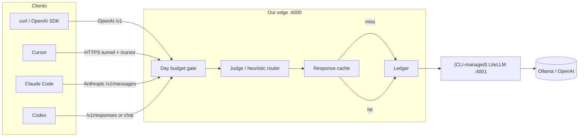

# Harbor AI Gateway

**Harbor** is a personal local AI gateway that wraps [LiteLLM](https://docs.litellm.ai/) with a thin edge you own: **day budget**, **heuristic + LLM-judge routing**, **exact + semantic response cache** (tokens saved), and a **ledger** on every request.

Goal: usable on one machine, something to build on — not an enterprise control plane.

Works anywhere you have **Python 3**, optional **Ollama** (local or remote), and optional cloud keys. Default hybrid pools: **cheap = Ollama**, **expensive = OpenAI** (`openai/gpt-4o-mini`). Everyday Ollama needs no cloud key; set `OPENAI_API_KEY` for expensive/heuristic traffic.

**License:** [MIT](LICENSE) · **Docs:** [docs/](docs/README.md) · **Security:** [docs/SECURITY.md](docs/SECURITY.md)

## Features (shipped)

| Feature | Status | Docs |
| --- | --- | --- |
| Exact + semantic response cache (incl. stream hit/miss) | **Shipped** | [docs/features/cache.md](docs/features/cache.md) |
| Heuristic + LLM judge routing (`judge_then_heuristic`) | **Shipped** | [docs/features/routing.md](docs/features/routing.md) |
| Hybrid pools (Ollama cheap + OpenAI expensive) | **Shipped** | [docs/features/hybrid.md](docs/features/hybrid.md) |
| Streaming SSE (chat + Anthropic messages) | **Shipped** | [docs/features/streaming.md](docs/features/streaming.md) |
| Cursor attach (`/cursor` + HTTPS tunnel) | **Shipped** | [docs/features/cursor.md](docs/features/cursor.md) |
| Claude Code / Codex surfaces (`/v1/messages`, `/v1/responses`) | **Shipped** | [architecture](docs/architecture.md) |
| OpenAI `/v1/responses` streaming | Planned (501 today) | [streaming](docs/features/streaming.md) |

## What we own vs wrap

| Layer | Owner |
| --- | --- |
| Day budget gate, router, response cache, ledger | **Us** (FastAPI edge `:4000`) |
| Provider adapters, keys, OpenAI-compatible proxy | **LiteLLM** (`:4001`, managed by CLI) |
| Cursor / Claude Code / Codex | **Clients** (attach via `config/clients/`) |

## High-level architecture



**Request path:** Client → edge `:4000` → budget → router → **cache** → ledger → (CLI-managed) LiteLLM `:4001` (or mock) → providers. Cache hits skip upstream.

## Quick start

### 1. Install

```bash
git clone https://github.com/sarjeet2013/harbor-ai-gateway.git
cd harbor-ai-gateway

python3 -m venv .venv
# Linux/macOS:
source .venv/bin/activate
# Windows:
#   .venv\Scripts\activate

pip install -r requirements.txt -r requirements-litellm.txt
```

> Skip `requirements-litellm.txt` only for mock mode (`GATEWAY_CONFIG=config/gateway.mock.yaml`).

### 2. Config + secrets

```bash
cp config/gateway.yaml.example config/gateway.yaml
cp .env.example .env
# Edit .env — set OPENAI_API_KEY only if you want expensive/OpenAI calls.
# Never commit .env or real keys. See docs/SECURITY.md.
```

`config/gateway.yaml` is **gitignored** (local override). The tracked template is `config/gateway.yaml.example` with `api_base: http://127.0.0.1:11434`. Point `api_base` at any reachable Ollama host if needed:

```bash
python -m edge models set --pool cheap --model qwen3:8b --api-base http://127.0.0.1:11434
# or any host: --api-base http://<ollama-host>:11434
```

### 3. Ollama (cheap pool)

Install and run [Ollama](https://ollama.com) on this machine (or another host), then pull models you configured:

```bash
ollama serve          # if not already running as a service
ollama pull qwen3:8b  # default cheap / judge model
# optional: ollama pull qwen2.5-coder:14b deepseek-r1:14b nomic-embed-text
```

Confirm reachability:

```bash
curl -s http://127.0.0.1:11434/api/tags | head
```

### 4. Start / stop

```bash
python -m edge doctor        # deps + soft-probe Ollama
python -m edge config-check
python -m edge start         # foreground (Ctrl+C stops edge + LiteLLM)
# or:
python -m edge start --detach
python -m edge status
python -m edge cache-stats
python -m edge stop
```

### 5. Smoke

```bash
./scripts/smoke.sh
# or mock (no Ollama / no cloud keys):
GATEWAY_CONFIG=config/gateway.mock.yaml python -m edge start
GATEWAY_CONFIG=config/gateway.mock.yaml ./scripts/smoke.sh
```

More Ollama detail: **[RUN_OLLAMA.md](RUN_OLLAMA.md)** · Hybrid notes: **[docs/features/hybrid.md](docs/features/hybrid.md)**.

## Endpoints (edge `:4000`)

| Method | Path | Client |
| --- | --- | --- |
| `POST` | `/v1/chat/completions` | curl / OpenAI SDK |
| `POST` | `/v1/messages` | Claude Code (Anthropic); edge→chat when `litellm` |
| `POST` | `/v1/responses` | Codex (`wire_api = "responses"`); edge→chat when `litellm` |
| `GET` | `/healthz` | ops |
| `GET` | `/v1/budget` | day spend snapshot |
| `*` | `/cursor/...` | Cursor attach — [docs/features/cursor.md](docs/features/cursor.md) |

### curl examples

```bash
curl -s http://127.0.0.1:4000/v1/chat/completions \
  -H 'Content-Type: application/json' \
  -d '{"model":"ollama-cheap","messages":[{"role":"user","content":"hi"}],"max_tokens":64}'

curl -s http://127.0.0.1:4000/v1/messages \
  -H 'Content-Type: application/json' \
  -H 'x-api-key: sk-local-gateway' \
  -H 'anthropic-version: 2023-06-01' \
  -d '{"model":"ollama-cheap","max_tokens":64,"messages":[{"role":"user","content":"hi"}]}'

curl -s http://127.0.0.1:4000/v1/responses \
  -H 'Content-Type: application/json' \
  -d '{"model":"ollama-cheap","input":"hi"}'
```

Client attach snippets: `config/clients/` (Claude Code, Codex, Cursor). Local bearer `sk-local-gateway` is a **placeholder**, not a provider key — see [docs/SECURITY.md](docs/SECURITY.md).

## Budget + router + ledger

- **Day budget** (`daily_budget_usd`): persisted to `data/budget.json`.
- **`on_budget_exceeded`**: `force_cheap` (default) or `reject` (HTTP 429).
- **Router**: live default `judge_then_heuristic` (local Ollama judge; keyword/length heuristic fallback). Client Harbor alias wins when `model` matches a configured name. See [routing.md](docs/features/routing.md).
- **Ledger**: JSONL at `logs/ledger.jsonl` — `model`, `reason`, `pool`, `tokens`, `cost_usd`, `status`, plus `cache_hit` / `cache_kind` / `tokens_saved*`.

## Cache

Disk cache under `data/cache/` — enabled by default. Template default is **`mode: exact`**. Set `mode: semantic` after `ollama pull nomic-embed-text` (exact-first, then cosine). Hits skip upstream and do not charge the day budget.

```bash
python -m edge cache-stats
```

Details: [docs/features/cache.md](docs/features/cache.md). Streaming: [docs/features/streaming.md](docs/features/streaming.md).

## Config layout

| Path | Role |
| --- | --- |
| `config/gateway.yaml.example` | **Tracked** public template (localhost Ollama) |
| `config/gateway.yaml` | **Local** override (gitignored) — `cp` from example |
| `config/gateway.mock.yaml` | Mock upstream for demos / CI |
| `config/.generated_litellm.yaml` | Auto-generated by CLI (gitignored) |
| `config/litellm_config.yaml` | Deprecated stub — do not edit |
| `.env.example` → `.env` | Provider keys (gitignored) |

Override path with `GATEWAY_CONFIG`. Legacy bare string pools still load; prefer the unified object shape.

## CLI reference

| Command | Purpose |
| --- | --- |
| `python -m edge start` | Generate LiteLLM YAML; start LiteLLM (if litellm mode) + edge |
| `python -m edge start --detach` (`-d`) | Background (`data/gateway.pid`) |
| `python -m edge stop` | Stop via pidfile / ports |
| `python -m edge status` | Ports, pids, upstream_mode, models |
| `python -m edge config-check` | Resolved aliases → `litellm_model` |
| `python -m edge models` / `models set` | List / edit cheap & expensive pools |
| `python -m edge cache-stats` | Hit rate + tokens saved |
| `python -m edge doctor` | Deps + soft-probe Ollama `api_base` |

Restart after `models set`: `python -m edge stop && python -m edge start`.

Logs: `logs/edge.log`, `logs/litellm.log`.

## Development

```bash
python3 -m venv .venv && source .venv/bin/activate   # Windows: .venv\Scripts\activate
pip install -r requirements.txt -r requirements-litellm.txt
cp config/gateway.yaml.example config/gateway.yaml
pytest
python -m edge doctor
```

Docker (optional mock edge):

```bash
docker compose up --build -d
./scripts/smoke.sh
```

## Scope

**In:** wrap LiteLLM; judge + heuristic routing; day USD budget; exact + semantic cache + tokens_saved; ledger; single YAML; CLI start/stop; client attach docs; mock mode; chat + Anthropic SSE.

**Out:** multi-user cloud, control-plane UI, Postgres, rebuilding clients. **Planned:** OpenAI Responses SSE (still 501).

## Packaging

Distribution roadmap: [docs/features/packaging.md](docs/features/packaging.md).
