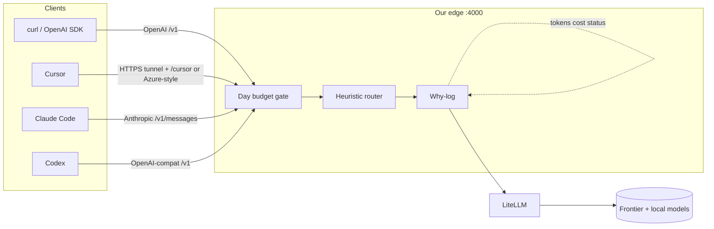

# local-llm-gateway

Personal **local** gateway that wraps [LiteLLM](https://docs.litellm.ai/) with a thin edge you own: **day budget**, **heuristic model router**, and a **why-log** on every request.

Goal: usable on one machine, something to build on — not an enterprise control plane.

## What we own vs wrap

| Layer | Owner |
| --- | --- |
| Day budget gate, heuristic router, why-log | **Us** (thin edge) |
| Provider adapters, keys, OpenAI-compatible proxy | **LiteLLM** |
| Cursor / Claude Code / Codex | **Clients** (attach via config below) |

## High-level architecture

**Request path:** Client → edge → budget check → router → why-log (start) → LiteLLM → provider → why-log (complete) → client.

## Honest v0 attach

| Client | Can hit bare `127.0.0.1`? | What you need |
| --- | --- | --- |
| curl / OpenAI SDK | Yes | `OPENAI_BASE_URL=http://127.0.0.1:4000/v1` |
| **Codex** | Yes (CLI/app on same machine) | `openai_base_url` in `~/.codex/config.toml` |
| **Claude Code** | Yes if local | `ANTHROPIC_BASE_URL` → Anthropic Messages surface |
| **Cursor** | **No** — requests leave Cursor cloud | Public **HTTPS** tunnel + Override Base URL (`…/cursor` or Azure fallback) |

See `config/clients/` for copy-paste snippets.

## v0 scope

**In:** wrap LiteLLM; heuristic cheap vs expensive; day USD budget; why-log; config YAML/env; client attach docs for Cursor, Claude Code, Codex.

**Out:** SpringLoom/Agentra, multi-user cloud, control-plane UI, Postgres, rebuilding clients.

## Kill criteria

If attach is so painful that you bypass the gateway on real work for a week → kill or redesign attach first.

## Status

Design / README review — implementation next after Leadership sign-off.
