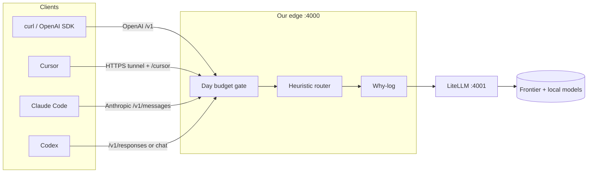

# local-llm-gateway

Personal **local** gateway that wraps [LiteLLM](https://docs.litellm.ai/) with a thin edge you own: **day budget**, **heuristic model router**, and a **why-log** on every request.

Goal: usable on one machine, something to build on — not an enterprise control plane.

## What we own vs wrap

| Layer | Owner |
| --- | --- |
| Day budget gate, heuristic router, why-log | **Us** (FastAPI edge `:4000`) |
| Provider adapters, keys, OpenAI-compatible proxy | **LiteLLM** (`:4001`) |
| Cursor / Claude Code / Codex | **Clients** (attach via `config/clients/`) |

## High-level architecture



**Request path:** Client → edge → budget check → router → why-log → LiteLLM (or mock) → why-log complete → client.

## Quick start (Ollama on Mac — real local models)

See **[RUN_OLLAMA.md](RUN_OLLAMA.md)** for arm64 / ~8GB setup:

- Pull `llama3.2:1b` (cheap) and `llama3.2:3b` (expensive)
- `upstream_mode: litellm` with LiteLLM on `:4001` → Ollama `:11434`
- Edge on `:4000`; smoke with curl + `logs/why.jsonl`

## Quick start (mock mode — no API keys)

Mock upstream is the default in `config/gateway.yaml` (`upstream_mode: mock`). The edge returns echo completions so curl works offline.

### Option A — Docker Compose

```bash
docker compose up --build -d          # edge only (mock mode)
./scripts/smoke.sh

# Optional LiteLLM sidecar (for upstream_mode: litellm):
# docker compose --profile litellm up --build -d
```

Edge listens on `http://127.0.0.1:4000`.

### Option B — Edge only (Python)

```bash
python3 -m venv .venv
source .venv/bin/activate
pip install -r requirements.txt
mkdir -p logs data
python -m uvicorn edge.main:app --host 0.0.0.0 --port 4000
# other terminal:
./scripts/smoke.sh
```

### Option C — Edge + LiteLLM CLI (real keys)

1. Copy `.env.example` → `.env` and set `OPENAI_API_KEY` / `ANTHROPIC_API_KEY`.
2. Set `upstream_mode: litellm` in `config/gateway.yaml`.
3. Start LiteLLM, then the edge:

```bash
# terminal 1
pip install 'litellm[proxy]'
litellm --config config/litellm_config.yaml --port 4001

# terminal 2
python -m uvicorn edge.main:app --host 0.0.0.0 --port 4000
```

Or use `docker compose up` with real keys in `.env` and `upstream_mode: litellm`.

## Endpoints (edge `:4000`)

| Method | Path | Client |
| --- | --- | --- |
| `POST` | `/v1/chat/completions` | curl / OpenAI SDK |
| `POST` | `/v1/messages` | Claude Code (Anthropic) |
| `POST` | `/v1/responses` | Codex (`wire_api = "responses"`) |
| `GET` | `/healthz` | ops |
| `GET` | `/v1/budget` | day spend snapshot |
| `*` | `/cursor/...` | Cursor via LiteLLM (needs `upstream_mode: litellm` + HTTPS tunnel) |

### curl examples

```bash
# OpenAI chat
curl -s http://127.0.0.1:4000/v1/chat/completions \
  -H 'Content-Type: application/json' \
  -d '{"model":"mock-cheap","messages":[{"role":"user","content":"hi"}]}'

# Anthropic messages (Claude Code)
curl -s http://127.0.0.1:4000/v1/messages \
  -H 'Content-Type: application/json' \
  -H 'x-api-key: sk-local-gateway' \
  -H 'anthropic-version: 2023-06-01' \
  -d '{"model":"mock-cheap","max_tokens":64,"messages":[{"role":"user","content":"hi"}]}'

# OpenAI responses (Codex)
curl -s http://127.0.0.1:4000/v1/responses \
  -H 'Content-Type: application/json' \
  -d '{"model":"mock-cheap","input":"hi"}'
```

## Budget + router + why-log

- **Day budget** (`daily_budget_usd`): tracked in memory and persisted to `data/budget.json`.
- **`on_budget_exceeded`**: `force_cheap` (default) or `reject` (HTTP 429).
- **Heuristic router**: cheap by default; expensive if prompt matches `router.expensive_keywords` or exceeds `expensive_min_chars`.
- **Why-log**: JSONL at `logs/why.jsonl` — each line has `model`, `reason`, `pool`, `tokens`, `cost_usd`, `status`.

## Client attach

Copy-paste snippets live under `config/clients/`:

| Client | Notes |
| --- | --- |
| curl / OpenAI SDK | `OPENAI_BASE_URL=http://127.0.0.1:4000/v1` |
| Claude Code | `ANTHROPIC_BASE_URL=http://127.0.0.1:4000` — needs `/v1/messages` |
| Codex | `openai_base_url` + optional `wire_api = "responses"` |
| Cursor | Public HTTPS tunnel + Override Base URL `…/cursor` (docs only; LiteLLM path) |

## Config

- `config/gateway.yaml` — edge (budget, pools, router, mock vs litellm)
- `config/litellm_config.yaml` — LiteLLM model list / providers
- `config/gateway.yaml.example` — template

## v0 scope

**In:** wrap LiteLLM; heuristic cheap vs expensive; day USD budget; why-log; YAML config; client attach docs; mock mode for demos.

**Out:** SpringLoom/Agentra, multi-user cloud, control-plane UI, Postgres, rebuilding clients.

## Kill criteria

If attach is so painful that you bypass the gateway on real work for a week → kill or redesign attach first.

## Status

v0 runnable: FastAPI edge + LiteLLM compose + mock smoke.
