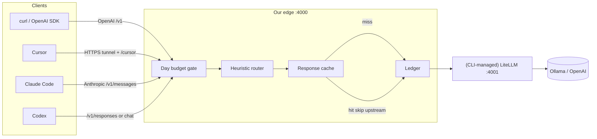

# Harbor AI Gateway — Architecture (v0)

Source of truth: `config/gateway.yaml` + `python -m edge` (see `edge/cli.py`, `edge/config.py`, `edge/main.py`, `edge/litellm_gen.py`, `edge/cache.py`, `edge/proxy.py`).

## Components

1. **Clients** — curl/SDK first; Codex (`/v1/responses` or chat); Claude Code (Anthropic `/v1/messages`); Cursor (public HTTPS + Harbor `/cursor` — see [features/cursor.md](features/cursor.md)).
2. **Edge (ours)** — FastAPI on `:4000` (`listen`); budget → router → **cache** → ledger before upstream. Started by `python -m edge start`. Cache hits **skip upstream**.
3. **Day budget** — spend-so-far vs `daily_budget_usd`; over budget → `on_budget_exceeded` (`force_cheap` | `reject`). Persisted to `budget_state_path` (default `data/budget.json`). Pure cache hits do **not** increment spend.
4. **Heuristic router** — classify request; pick from `models.cheap` / `models.expensive` pools (alias = each entry’s `name`).
5. **Response cache** — exact hash cache on disk (`data/cache/`); see [features/cache.md](features/cache.md). **Semantic cache** and **intelligent (judge) routing** are **planned after exact cache** (not built yet).
6. **Ledger** — JSONL at `ledger_path` (default `logs/ledger.jsonl`): model, reason, pool, tokens, cost, status, plus cache fields when implemented (`cache_hit`, `cache_kind`, `tokens_saved*`).
7. **Translate** — `edge/translate.py` maps Anthropic Messages and OpenAI Responses to OpenAI Chat Completions (and back) when `upstream_mode: litellm`, so Ollama/LiteLLM only need chat.
8. **Upstream** — `upstream_mode: mock` (echo completions, no keys) or `litellm` (CLI-managed proxy on `litellm_host`:`litellm_port`, default `127.0.0.1:4001`).
   Default pools are **hybrid**: Ollama cheap + OpenAI expensive — see [features/hybrid.md](features/hybrid.md).
   Chat **streaming** (`stream: true` on `/v1/chat/completions`) is SSE passthrough; other surfaces return 501 for `stream: true`. See [features/streaming.md](features/streaming.md).
9. **Config** — single canonical `config/gateway.yaml`. LiteLLM YAML is **generated** to `config/.generated_litellm.yaml` (override with `GATEWAY_LITELLM_CONFIG`). Do not hand-edit `config/litellm_config.yaml` (deprecated stub).

## Surfaces (edge)

| Path | Purpose |
| --- | --- |
| `GET /healthz` | Health + budget snapshot (+ cache stats) |
| `GET /v1/budget` | Day spend snapshot |
| `POST /v1/chat/completions` | OpenAI Chat Completions (incl. `stream: true` SSE) |
| `POST /v1/messages` | Anthropic Messages (Claude Code); in `litellm` mode edge translates ↔ chat/completions |
| `POST /v1/responses` | OpenAI Responses (Codex `wire_api=responses`); in `litellm` mode edge translates ↔ chat/completions |
| `/cursor/*` | Harbor chat/models via `_handle`; other paths fall back to LiteLLM `/v1/*` |

## CLI

| Command | Purpose |
| --- | --- |
| `python -m edge start` | Generate LiteLLM YAML; start LiteLLM (if litellm mode) + edge; foreground |
| `python -m edge start --detach` (`-d`) | Same, background (`data/gateway.pid`) |
| `python -m edge stop` | Stop via pidfile / ports |
| `python -m edge status` | Ports, pids, `upstream_mode`, model pools |
| `python -m edge config-check` | Print resolved aliases → `litellm_model` |
| `python -m edge cache-stats` | Hit rate + total `tokens_saved` from ledger (+ disk entry count) |

## Diagram

Same path for all clients once traffic hits the edge: clients → edge `:4000` → budget → router → **cache** → ledger → (CLI-managed) LiteLLM `:4001` (or mock) → providers. Cache hits return immediately after ledger (no upstream).

## Planned (not yet shipped)

- **Messages / Responses streaming** — chat SSE is shipped; Anthropic `/v1/messages` and OpenAI `/v1/responses` with `stream: true` still return 501. See [features/streaming.md](features/streaming.md).
- **Semantic cache** (embeddings + cosine threshold) — see [features/cache.md](features/cache.md).
- **Intelligent / judge routing** — after cache; heuristic router remains the shipping path today.
