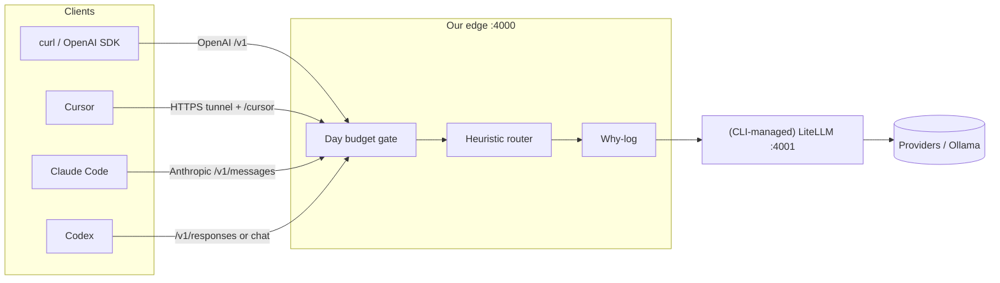

# Architecture (v0)

Source of truth: `config/gateway.yaml` + `python -m edge` (see `edge/cli.py`, `edge/config.py`, `edge/main.py`, `edge/litellm_gen.py`).

## Components

1. **Clients** — curl/SDK first; Codex (`/v1/responses` or chat); Claude Code (Anthropic `/v1/messages`); Cursor (public HTTPS + LiteLLM `/cursor`).
2. **Edge (ours)** — FastAPI on `:4000` (`listen`); budget → router → why-log before upstream. Started by `python -m edge start`.
3. **Day budget** — spend-so-far vs `daily_budget_usd`; over budget → `on_budget_exceeded` (`force_cheap` | `reject`). Persisted to `budget_state_path` (default `data/budget.json`).
4. **Heuristic router** — classify request; pick from `models.cheap` / `models.expensive` pools (alias = each entry’s `name`).
5. **Why-log** — JSONL at `why_log_path` (default `logs/why.jsonl`): model, reason, pool, tokens, cost, status.
6. **Upstream** — `upstream_mode: mock` (echo completions, no keys) or `litellm` (CLI-managed proxy on `litellm_host`:`litellm_port`, default `127.0.0.1:4001`).
7. **Config** — single canonical `config/gateway.yaml`. LiteLLM YAML is **generated** to `config/.generated_litellm.yaml` (override with `GATEWAY_LITELLM_CONFIG`). Do not hand-edit `config/litellm_config.yaml` (deprecated stub).

## Surfaces (edge)

| Path | Purpose |
| --- | --- |
| `GET /healthz` | Health + budget snapshot |
| `GET /v1/budget` | Day spend snapshot |
| `POST /v1/chat/completions` | OpenAI Chat Completions |
| `POST /v1/messages` | Anthropic Messages (Claude Code) |
| `POST /v1/responses` | OpenAI Responses (Codex `wire_api=responses`) |
| `/cursor/*` | Proxied to LiteLLM when `upstream_mode: litellm` |

## CLI

| Command | Purpose |
| --- | --- |
| `python -m edge start` | Generate LiteLLM YAML; start LiteLLM (if litellm mode) + edge; foreground |
| `python -m edge start --detach` (`-d`) | Same, background (`data/gateway.pid`) |
| `python -m edge stop` | Stop via pidfile / ports |
| `python -m edge status` | Ports, pids, `upstream_mode`, model pools |
| `python -m edge config-check` | Print resolved aliases → `litellm_model` |

## Diagram

Same path for all clients once traffic hits the edge: clients → edge `:4000` → (CLI-managed) LiteLLM `:4001` → providers.
